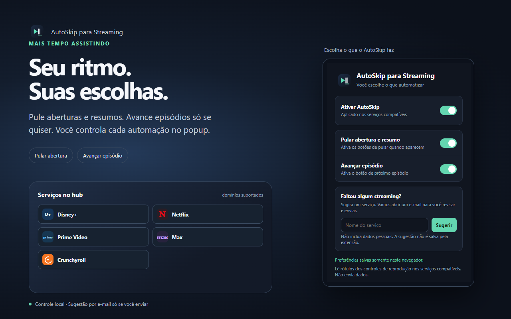
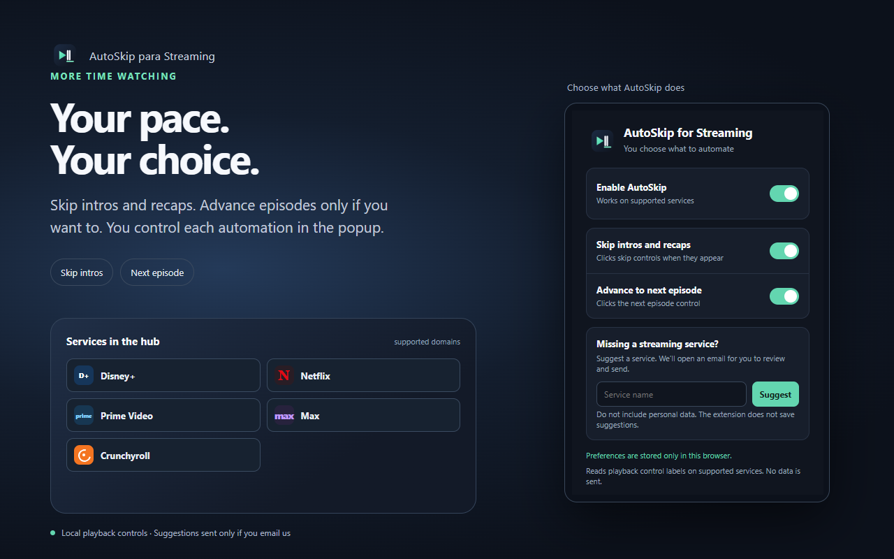

# AutoSkip para Streaming

Versão em inglês: [README.en.md](README.en.md).

Extensão Manifest V3 localizada em português do Brasil e inglês. Pula aberturas/resumos e avança para o próximo episódio em Disney+, Netflix, Prime Video e Max. Na Netflix, também reconhece controles para pular resumos, créditos e anúncios quando disponibilizados pela plataforma. Na Crunchyroll, reconhece controles para pular introdução, resumo e créditos; a disponibilidade depende do título e da própria plataforma. O popup permite controlar as ações e preparar um e-mail de sugestão para `autoskipstreamings@outlook.com`.

## Instalação

Funciona no computador. Não precisa instalar Node nem rodar `npm install`.

1. Baixe o [ZIP do projeto](https://github.com/SteffanoG/autoskip-streaming/archive/refs/heads/main.zip) e extraia em uma pasta fixa. Se a pasta for apagada ou movida, a extensão para de funcionar.
2. Abra `chrome://extensions` no Chrome.
3. Ative **Modo do desenvolvedor**.
4. Escolha **Carregar sem compactação** e selecione a pasta que contém o arquivo `manifest.json` (no ZIP extraído, `autoskip-streaming-main`).
5. Recarregue as abas de streaming que já estavam abertas.

### Atualização

A atualização é manual.

- **Pelo ZIP:** baixe de novo, substitua os arquivos na mesma pasta e clique em recarregar no cartão da extensão em `chrome://extensions`.
- **Pelo git:** clone uma vez com `git clone https://github.com/SteffanoG/autoskip-streaming.git`. Para atualizar, rode `git pull` na pasta e recarregue a extensão.

Depois de recarregar a extensão, recarregue também as abas de streaming abertas.

O manifesto limita a injeção aos domínios dos serviços listados. A permissão `storage` salva as preferências do popup no perfil local do Chrome.

## Testes locais

Instale as dependências com `npm install` e execute `npm test`. O harness usa o Chrome instalado na máquina e simula controles de página; verifica as regras específicas, o fallback, o envio de sugestão e as duas traduções do popup. Esses testes não confirmam mudanças de interface nem comportamento autenticado nos serviços reais. `npm run package:store` gera o ZIP de distribuição e as imagens de listagem em português e inglês.

## Limites conhecidos

- Os serviços podem mudar seus seletores sem aviso; nesse caso, a cobertura específica pode deixar de funcionar.
- O fallback depende dos rótulos acessíveis ou do texto do botão e não cobre todos os idiomas.
- A extensão clica em controles reconhecidos e habilitados no popup. As plataformas podem mudar os seletores sem aviso, então a compatibilidade real precisa ser validada antes do envio.
- O campo de sugestões abre um e-mail para `autoskipstreamings@outlook.com`; o usuário revisa e envia no próprio cliente de e-mail.
- Antes de publicar, hospede `privacy-policy.html` e `privacy-policy.en.html` em URLs públicas HTTPS e preencha os campos localizados do Developer Dashboard usando os rascunhos em `store-listing/`.

## Materiais da loja

Os textos de listagem estão em `store-listing/`. O ZIP de distribuição é criado em `dist/` e fica fora do Git.
